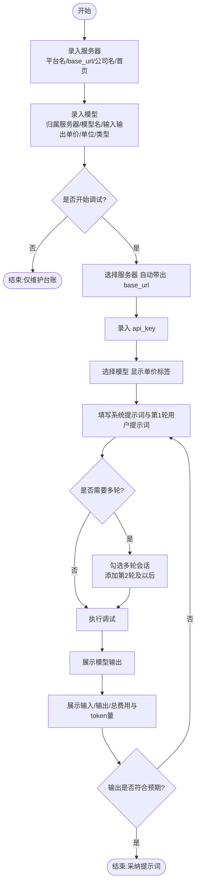
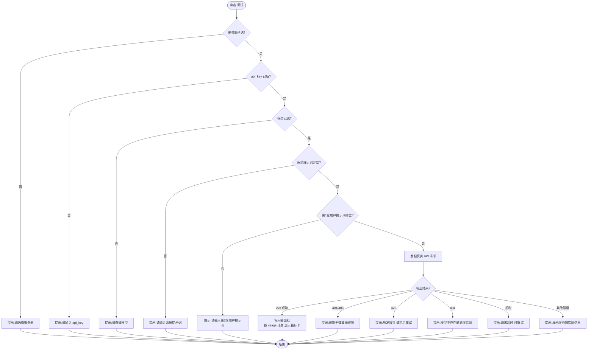

# Test_Prompt · 提示词调试工具｜需求规格说明书 v1.0

> **模板来源**：《PRD 模板 · 橘朵标准框架 v1.0》（擎自《橘朵 Judydoll · 会员管理系统.pdf》35 页 + 《PRD文档规范与图表绘制宣讲》）。
> **本期范围**：以 Test_Prompt HTML 原型（list_server / server / mode_list / model_add / prompt_dis / server_detail）与 SQLite + Streamlit 实现为基线，反向整理为正式 PRD。
> **占位符约定**：`【待确认：…】` 表示需由产品负责人拍板的事项；`【待补充：…】` 表示需由业务方提供的信息（本期不代为推断）。

---

## 1、卷首信息

### 1.1 文档创建信息（表）

| 产品项目名称 | Test_Prompt · 提示词调试工具 | 产品项目编号 | 【待补充：项目编号/内部代号】 |
|---|---|---|---|
| 产品经理 | 【待补充：姓名】 | 项目经理 | — |
| 创建日期 | 2026-09-27 | 总页数 | 约 【待排版后填写】 |
| 正文页数 | 【待排版后填写】 | 附录页数 | 【待排版后填写】 |

### 1.2 文档修订记录（表）

| 修改日期 | 修改的章节 | 修改类型 | 修改描述 | 修改人 | 审核人 | 版本号 |
|---|---|---|---|---|---|---|
| 2026-09-27 | 所有 | A | 1）依据 Test_Prompt HTML 原型与 SQLite/Streamlit 实现反查，建立本文档；2）确定「调试」采用真实大模型 API 调用；3）建立 §1.8 指标口径表作为全文档唯一数字口径来源；4）按需求负责人指示，项目背景（§1.6）保留为待补充占位 | 【待补充：姓名】 | — | 1.0 |

> 修改类型：A–ADDED（增加）　M–MODIFIED（修改）　D–DELETED（删除）

### 1.3 目的（两段式：目的段 + 核心目标句）

**本文档旨在**明确 Test_Prompt · 提示词调试工具的**业务需求、功能范围与权责边界**，作为产品设计、技术开发、测试验收及后续迭代的统一依据。

**本系统核心目标为**：通过**服务器（API 服务方）与模型的统一台账管理**与**系统/多轮提示词的在线调试执行**，配合**基于真实接口返回的 token 用量与单价的费用测算**，实现"在一个工具内完成提示词编写—调试—成本核算"的闭环，提升**提示词调试效率**与**调用成本的可核算性**。

### 1.4 预期读者（两张表）

**表 A：读者角色 × 关注点**

| 读者角色 | 所属部门 | 关注重点 | 阅读用途 |
|---|---|---|---|
| 使用者（提示词编写者） | 【待补充：所属团队】 | 服务器/模型台账如何维护、调试如何执行、费用如何看 | 日常操作与结果核对 |
| 研发工程师 | 【待补充：技术团队】 | 字段定义、约束、接口调用协议、错误分支 | 实现依据 |
| 测试 / 验收人 | 【待补充：测试团队】 | 用例（含异常流）、校验规则、降级表现 | 验收对照基线 |

**表 B：部门-角色-职责**

| 部门 | 角色定位 | 业务要求与职责 |
|---|---|---|
| 【待补充：部门】 | 使用者（兼需求提出方） | 维护服务器与模型台账的准确性（尤其单价、单位）；执行调试并人工判断模型输出是否符合预期——**模型输出由使用者自行判断采纳，工具不代为判定质量** |
| 【待补充：技术团队】 | 研发 | 按 §3 字段与约束实现；按 §5.4 实现边界与降级 |
| 【待补充：测试团队】 | 验收 | 按 §3 各页用例说明（含异常事件流）逐条验证 |

> 本期为**单人使用的本地工具**，无多人审批流；因此不设"运营审核 AI 结果"环节，输出采纳责任归属使用者本人。

### 1.5 名词解释（表：序号 / 术语或缩略语 / 说明性定义）

| 序号 | 术语或缩略语 | 说明性定义 |
|---|---|---|
| 1 | 服务器 / 服务平台 | 提供大模型 API 的服务方记录，含 plat_name（平台/官方名）、base_url（API 根地址）、company（公司名）、homepage（首页）。**不是物理主机**。示例：OpenAI、阿里云通义 |
| 2 | base_url | 模型服务的 API 根地址（1 条服务器记录 1 个）。示例：https://api.openai.com/v1 |
| 3 | api_key | 调用该服务所需的密钥凭据；调试时由使用者现场输入，是否在本地留存见【待确认 C3】 |
| 4 | 模型 / Model | 从属于某一服务器的可用模型及其计费单价，含 model_name、in_token_fee、out_token_fee、unit、type、url |
| 5 | token | 模型计量的最小单位；本工具不自行切词，以服务端返回的用量为准（口径见 §1.8） |
| 6 | 输入 token 费 | 本次调试的输入侧费用 = 输入 token 数 ÷ 单位系数 × 输入单价 |
| 7 | 输出 token 费 | 本次调试的输出侧费用 = 输出 token 数 ÷ 单位系数 × 输出单价 |
| 8 | 总费 | 输入 token 费 + 输出 token 费（单次成功调用） |
| 9 | 单位（unit） | 单价所对应的 token 批量：K / 万 / 十万 / 百万，换算系数见 §1.8 |
| 10 | 类型（type） | 模型能力标签：对话 / 视频 / 嵌入 / 生图 / 语音 / 重排；支持多选，存储为逗号分隔字符串 |
| 11 | 多轮会话 | 在一次调试中提交多轮"用户提示词"，用于验证上下文连贯场景 |
| 12 | 轮次 | 用户提示词的输入次序，第 1 轮为默认输入框，第 2 轮及以后由"多轮会话"动态添加 |
| 13 | P0 / P1 / P2 | 需求优先级：P0 本期必须上线；P1 重要紧随其后；P2 增强项可后续迭代 |

### 1.6 项目背景（四段式：现状 → 痛点 → 痛点必须被解决 → 项目目标）

> 本节涉及真实业务现状与量化痛点，按需求负责人要求**不代为推断**，已保留结构化占位。填写时请逐段替换，并保证"痛点 → §1.6 第 4 段能力"与 §2.1 优先级表一一对应。

**1. 企业现状**
【待补充：公司/团队背景一句话 + 目前如何做模型接入与提示词验证（用什么工具/脚本/平台）+ 现有方式的规模数据（如接入平台数、维护模型数、日均调试次数）+ 现有做法的局限一句话】

**2. 面临的痛点**
- 【待补充：痛点 1 —— 现象一句话 + 后果。例：服务器地址与模型单价散落在表格/文档里，用前要反复翻查】
- 【待补充：痛点 2 —— 例：验证多轮提示词需反复粘贴到不同平台控制台】
- 【待补充：痛点 3 —— 例：不同平台 token 计费单位不一致，成本只能事后估算】
- 【待补充：痛点 4（可选）—— 若无请写"无"】

**3. 痛点需要被解决**
【待补充：为什么现在必须解决 —— 不解决的量化/定性后果（工时、返工、成本失控）+ 解决后预期得到什么】

**4. 项目目标**
在【待补充：现有做法】基础上引入【能力 1/2/3】，针对性破解上述痛点：
- 服务器与模型统一台账（增删改查 + 按平台/类型/费用区间检索）：****→ 破解【待补充：痛点编号】
- 提示词在线调试（系统提示词 + 第 1 轮 + 多轮，真实调用 API）：→ 破解【待补充：痛点编号】
- 按真实 token 用量 × 单价测算费用并展示：→ 破解【待补充：痛点编号】

### 1.7 系统定位（一段）

Test_Prompt 是面向**提示词编写者**的**本地轻量提示词调试与成本测算工具**，以**服务器/模型台账管理 + 提示词在线调试**为核心，帮助使用者在一个工作台内完成"选服务 → 选模型 → 写提示词 → 执行 → 看输出与费用"的闭环动作，最终提升**调试效率**与**调用成本的可核算程度**。

### 1.8 指标口径表（**全文档唯一口径来源**）

**A. token 与费用口径**

| 指标 | 计算口径 | 是否计入失败/重试 | 统计时间范围 |
|---|---|---|---|
| 输入 token 数 | 优先取服务端响应 usage 中的 `prompt_tokens`；服务端未返回时，降级按 `(系统提示词 + 全部用户轮次) 字符总数 ÷ 2` 向上取整估算，并在界面标注"估算值" | 仅计**成功的单次调用**（HTTP 2xx 且返回正文）；失败调用（4xx/5xx/超时）**不计入 token 与费用** | 单次调试请求（不做跨次累计） |
| 输出 token 数 | 优先取 `completion_tokens`；缺失时按 `回复正文字符数 ÷ 2` 向上取整估算，界面标注"估算值" | 同上 | 同上 |
| 总 token 数 | 输入 token 数 + 输出 token 数 | 同上 | 同上 |
| 输入 token 费 | `(输入 token 数 ÷ 单位系数) × 该模型输入单价(in_token_fee)` | 同上 | 同上 |
| 输出 token 费 | `(输出 token 数 ÷ 单位系数) × 该模型输出单价(out_token_fee)` | 同上 | 同上 |
| 总费 | 输入 token 费 + 输出 token 费 | 同上 | 同上 |

**B. 单位（unit）换算系数**

| unit 取值 | 含义 | 单位系数（token 数需除以的值） |
|---|---|---|
| K | 每 1 千 tokens | 1,000 |
| 万 | 每 1 万 tokens | 10,000 |
| 十万 | 每 10 万 tokens | 100,000 |
| 百万 | 每 100 万 tokens | 1,000,000 |

**C. 计数与展示口径**

| 项 | 口径 |
|---|---|
| 金额币种与精度 | 人民币 ¥，界面固定展示 **4 位小数**（例：¥0.0000）；中间计算保留更高精度，展示时四舍五入 |
| 列表"共 N 条" | 当前筛选条件下返回的记录条数（去重以主键计数），不含已删除记录 |
| token 数展示 | 整数；估算所得时在相邻位置显示"估算"标记 |
| 费用换算依据 | 以**模型记录中当时填写的 in_token_fee / out_token_fee / unit** 为准；厂商官网调价后需由使用者手动更新台账（本工具不自动同步，见【待确认 C5】） |

> 全文凡出现上述数字，一律以上表为准；后续页面不再重复定义。

---

## 2、项目范围与角色

### 2.1 功能范围与子模块优先级（表）

| 1 级菜单 | 2 级功能 / 按钮 | 优先级 | 说明 |
|---|---|---|---|
| 基础信息 / 模型服务器 | 服务器列表 | P0 | 展示全部服务器，支持按平台名、公司名检索；支持勾选与批量删除 |
| 基础信息 / 模型服务器 | 添加服务器 | P0 | 新增一条服务器记录（平台名、base_url、公司名、首页） |
| 基础信息 / 模型服务器 | 删除服务器（批量） | P0 | 勾选后删除；存在外键模型时按级联规则处理，见【待确认 C2】 |
| 基础信息 / 模型服务器 | 服务器详情 | P1 | 查看单条服务器信息及其下挂模型列表 |
| 基础信息 / 模型 | 模型列表 | P0 | 展示全部模型，支持平台/类型/模型名/费用区间检索；支持勾选与批量删除 |
| 基础信息 / 模型 | 添加模型 | P0 | 新增一条模型记录（含单价、单位、类型多选、网址） |
| 基础信息 / 模型 | 删除模型（批量） | P0 | 勾选后删除 |
| 提示词调试 | 基础配置（服务器/密钥/模型） | P0 | 选择服务器自动带出 base_url；录入 api_key；选择模型展示费用标签 |
| 提示词调试 | 系统提示词 / 第 1 轮用户提示词 | P0 | 必填，执行前强校验 |
| 提示词调试 | 多轮会话（动态增删轮次） | P0 | 勾选后展开第 2 轮及以后，支持逐轮删除与重新编号 |
| 提示词调试 | 执行调试（真实 API 调用） | P0 | 发起真实请求，返回模型输出与 token 用量并按 §1.8 计费 |
| 提示词调试 | 费用指标卡（输入/输出/总） | P0 | 展示费用与对应 token 量，口径见 §1.8 |
| 提示词调试 | 复制（各提示词框与输出框） | P1 | 复制到剪贴板 |
| 提示词调试 | 重置 | P1 | 清空配置、提示词、多轮、输出与指标卡 |
| 全局 | 三级菜单导航 | P0 | 基础信息 → 模型服务器 / 模型 → 三级页面；提示词调试为一级入口 |
| 数据层 | SQLite 库 Prompt_Test_DB（server / model 两表） | P0 | 表结构与关系见附录 D |

### 2.2 用户角色（表：角色 / 职责说明）

| 角色 | 职责说明 |
|---|---|
| 使用者 | 本工具为**单人本地使用**，不设多角色权限。使用者拥有全部操作权限：维护服务器与模型台账、执行调试、查看费用、删除数据；并对模型输出的质量判断与采纳负责 |

> 说明：本期不设管理员/只读/运营等多角色，故无权限矩阵与审批流。若后续引入多人协作，需补充角色表与权限矩阵（见【待确认 C1】）。

### 2.3 业务流程图

**图 A：整体使用流程（Mermaid，可复制到飞书/Mermaid Live 渲染）**



| 序号 | 环节 | 责任人 | 输入 | 输出 |
|---|---|---|---|---|
| 1 | 录入服务器 | 使用者 | 平台方公开信息 | server 表一条记录 |
| 2 | 录入模型 | 使用者 | 选定的服务器 + 模型资料页 | model 表一条记录（含 svc_id 外键） |
| 3 | 基础配置 | 使用者 | 服务器、api_key、模型 | base_url 自动带出、单价标签展示 |
| 4 | 编写提示词 | 使用者 | 系统提示词、第 1 轮用户提示词（可选多轮） | 完整的请求提示词集合 |
| 5 | 执行调试 | 系统 | 上述配置 + 提示词 | 模型输出正文 + token 用量 |
| 6 | 费用测算 | 系统 | token 用量 + 台账单价/单位 | 三张费用指标卡（口径 §1.8） |
| 7 | 判断与迭代 | 使用者 | 模型输出 + 费用 | 采纳或修改后回到环节 4 重试 |

**图 B：调试执行逻辑判断图（覆盖异常分支）**



### 2.4 跨系统时序图（调试请求）

```mermaid
sequenceDiagram
  participant U as 使用者
  participant UI as Test_Prompt前端
  participant DB as SQLite(Prompt_Test_DB)
  participant SYS as 后端
  participant LLM as 厂商API(base_url)
  U->>UI: 选择服务器/填写api_key/选择模型
  UI->>DB: 读取 server.base_url、model 单价与单位
  DB-->>UI: 返回配置
  U->>UI: 填写提示词并点击 调试
  UI->>SYS: 提交(server, key, model, 提示词轮次)
  SYS->>SYS: 必填校验(见 2.3 图B)
  SYS->>DB: 读取该模型的单价/单位
  DB-->>SYS: in_token_fee/out_token_fee/unit
  SYS->>LLM: POST {base_url}/chat/completions Bearer api_key
  LLM-->>SYS: 200 + content + usage(prompt_tokens,completion_tokens)
  SYS->>SYS: 按 §1.8 计算输入/输出/总费
  SYS-->>UI: 输出正文 + 三张指标卡
  UI-->>U: 展示结果
  Note over SYS,LLM: 异常分支见 §5.4 边界与降级;<br/>失败调用不计入 token 与费用(§1.8)
```

> Note：请求协议与路径以【待确认 C4】的结论为准；上图按"统一 OpenAI 兼容协议"示意。是否落库调用日志取决于【待确认 C6】，当前表设计中无调用日志表。

---

## 3、功能需求详情（**主体章节，按页面展开**）

> 本章每个页面均使用同一套五件套：`区域说明 → 字段清单 → 数据操作 → 用例说明 → 字段校验规则 → 对话框详情`。

---

### 3.0 页：【产品布局】（固定第一页）

整体布局为三块：**左上角品牌区（Logo + 工具名 Test_Prompt）**、**左侧三级导航菜单**、**右侧内容区（含顶栏面包屑与页面主体）**。

**图：产品布局总览（请贴图：`产品布局.png`，红框序号对应下表）**
> 【待贴图：以 list_server.html 打开后的整页截图为准，按 1/2/3 三个红框标注】

**布局说明**

| 序号 | 区域名称 | 区域说明 |
|---|---|---|
| 1 | 品牌区 | 左上角显示 Logo（字母 T）与工具名 `Test_Prompt`，全站固定位置，不可点击跳转 |
| 2 | 左侧导航（三级） | 一级：基础信息、提示词调试；二级（基础信息下）：模型服务器、模型；三级：模型服务器下为「服务器列表 / 添加服务器」，模型下为「模型列表 / 添加模型」。菜单项常驻展开，点击任意层级均跳转到对应页面 |
| 3 | 内容区 | 顶栏显示面包屑（如「基础信息 / 模型服务器」）与页面标题；下方为页面主体卡片（列表 / 表单 / 调试工作台） |

---

### 3.1 页：【服务器列表】

使用者在本页查看、检索与删除服务器台账，并可跳转至新增页与详情页。

**图：服务器列表区域标注（请贴图：`服务器列表_区域标注.png`）**
> 【待贴图：以 list_server.html 截图，红框序号 1–4 对应下表】

#### 3.1.1 区域说明

| 序号 | 区域名称 | 区域说明 |
|---|---|---|
| 1 | 搜索区 | 「平台/官方名」文本框 +「公司名」文本框 + 搜索 / 重置 按钮，均为模糊匹配 |
| 2 | 操作区 | 右上角：**删除**（未勾选时禁用；勾选后可点击并二次确认）、**添加服务器**（超链接按钮，跳转 §3.2） |
| 3 | 列表区 | 首列为复选框（表头复选框支持全选/取消全选）；列：平台/官方名、公司名、api 接口(base_url)；平台/官方名与公司名为超链接，跳转 §3.5 服务器详情 |
| 4 | 面包屑区 | 显示「基础信息 / 模型服务器」与页面标题「服务器列表」 |

#### 3.1.2 字段清单（**核心表**）

| 数据项名称 | 数据项描述 | 数据项类型 | 默认显示 | 可修改 | 可排序 | 数据约束 |
|---|---|---|---|---|---|---|
| 选择（复选框） | 行勾选框，表头为全选框 | 复选框 | 是 | 是（勾选态） | 否 | 取值：选中 / 未选中；全选仅作用于当前筛选结果的可见行 |
| id | 服务器主键 | 显示项 | 是 | 否 | 是 | SQLite INTEGER 自增主键 |
| 平台/官方名 | 平台或官方名称 | 显示项（超链接） | 是 | 否 | 否 | 必填，长度 ≤100；取值示例：OpenAI、阿里云通义、DeepSeek |
| 公司名 | 服务所属公司主体 | 显示项（超链接） | 是 | 否 | 否 | 必填，长度 ≤100；取值示例：OpenAI Inc、阿里巴巴 |
| api 接口(base_url) | 该服务的 API 根地址 | 显示项 | 是 | 否 | 否 | 必填，长度 ≤255；示例 https://api.openai.com/v1 |
| 首页（详情页字段） | 服务官网地址 | 显示项 | 否（列表不展示） | 否 | 否 | 选填，长度 ≤255 |

> 注：列表不直接展示「首页」，该字段仅在 §3.5 详情页展示。

#### 3.1.3 数据操作（表）

| 操作按钮 | 操作描述 | 提示类型 | 提示信息内容 |
|---|---|---|---|
| 搜索 | 按「平台/官方名」「公司名」模糊匹配过滤列表 | 文本提示 | 无结果时：「没有符合条件的服务器。」 |
| 重置 | 清空两个搜索框并恢复全量列表 | 文本提示 | 「已重置（恢复全部列表）」 |
| 全选 | 勾选表头复选框，选中当前页全部行 | — | — |
| 删除 | 对勾选行批量删除 | 确认对话框 + 文本提示 | 确认框：「确定删除选中的 N 个服务器吗？删除后其下模型也会一并删除。」；成功后：「已删除。」 |
| 添加服务器 | 跳转新增页 | — | — |
| 平台/官方名（链接） | 跳转该服务器详情页 | — | — |
| 公司名（链接） | 跳转该服务器详情页 | — | — |

#### 3.1.4 用例说明

**用例：搜索服务器**
- 参与者：使用者
- 前置条件：位于服务器列表页，列表已有数据
- 基本事件流：在「平台/官方名」输入关键字 → 点击「搜索」 → 列表刷新为命中结果，并更新"共 N 条"
- 可选事件流：仅在「公司名」输入 → 按公司名过滤；两个条件同时输入 → 需同时满足（AND）
- 异常事件流：1）无任何匹配 → 提示「没有符合条件的服务器。」；2）输入含首尾空格 → 自动去除后参与匹配
- 后置条件：列表展示命中结果；"共 N 条"按筛选结果计数（口径见 §1.8 C）

**用例：批量删除服务器**
- 参与者：使用者
- 前置条件：列表至少有一行被勾选
- 基本事件流：勾选若干行 → 点击「删除」 → 弹出确认框 → 点击确定 → 删除成功，列表刷新
- 可选事件流：点击「全选」一次性勾选当前全部行后再删除
- 异常事件流：1）未勾选任何行 → 删除按钮禁用（不可点击）；2）确认框中点击取消 → 数据不变，回到列表
- 后置条件：被选中的服务器及其外键关联的模型按【待确认 C2】的规则处理（默认按数据库级联删除）

#### 3.1.5 字段校验规则（表）

| 字段 | 必填 | 格式 / 长度限制 | 错误提示样式 |
|---|---|---|---|
| 平台/官方名（搜索） | 否 | 无限制，模糊匹配 | — |
| 公司名（搜索） | 否 | 无限制，模糊匹配 | — |

#### 3.1.6 对话框详情

**① 删除确认对话框**
前置条件：至少勾选 1 行后点击「删除」。

**图：删除确认对话框截图**
> 【待贴图：`服务器列表_删除确认.png`】

字段清单

| 数据项名称 | 数据项描述 | 数据项类型 |
|---|---|---|
| 确认文案 | 展示待删除条数与级联影响说明 | 显示项 |
| 确定 | 执行删除 | 操作项 |
| 取消 | 关闭对话框，不做改动 | 操作项 |

数据操作

| 操作按钮 | 操作描述 | 提示类型 | 提示信息内容 |
|---|---|---|---|
| 确定 | 执行批量删除 | 文本提示 | 「已删除。」 |
| 取消 | 关闭对话框 | — | — |

---

### 3.2 页：【添加服务器】

使用者通过表单登记一个新的模型服务方（平台名、API 根地址、公司名、首页），保存后回到列表页。

**图：添加服务器区域标注（请贴图：`添加服务器_区域标注.png`）**
> 【待贴图：以 server.html 截图，红框序号 1–3 对应下表】

#### 3.2.1 区域说明

| 序号 | 区域名称 | 区域说明 |
|---|---|---|
| 1 | 面包屑区 | 显示「基础信息 / 模型服务器」与标题「添加服务器」 |
| 2 | 常用平台快捷区 | 「常用平台」下拉（硅基流动 / OpenRouter / 魔搭社区 / OpenAI），选中后将值填入「平台/官方名」输入框 |
| 3 | 表单区 | 平台/官方名（可编辑下拉，可自定义输入）、api 网址(base_url)、公司名、首页；底部「保存 / 取消」按钮 |

#### 3.2.2 字段清单（**核心表**）

| 数据项名称 | 数据项描述 | 数据项类型 | 默认显示 | 可修改 | 可排序 | 数据约束 |
|---|---|---|---|---|---|---|
| 常用平台 | 预设平台快捷选择 | 下拉项 | 是 | 是 | 否 | 枚举：空 / 硅基流动 / OpenRouter / 魔搭社区 / OpenAI；选择后回填平台/官方名 |
| 平台/官方名 | 平台或官方名称，`*` 必填 | 下拉项（可编辑） | 是 | 是 | 否 | 必填，长度 ≤100 |
| api 网址(base_url) | API 根地址，`*` 必填 | 显示项（输入框） | 是 | 是 | 否 | 必填，长度 ≤255 |
| 公司名 | 公司主体，`*` 必填 | 显示项（输入框） | 是 | 是 | 否 | 必填，长度 ≤100 |
| 首页 | 官网地址 | 显示项（输入框） | 是 | 是 | 否 | 选填，长度 ≤255 |

#### 3.2.3 数据操作（表）

| 操作按钮 | 操作描述 | 提示类型 | 提示信息内容 |
|---|---|---|---|
| 保存 | 校验必填后写入 server 表并跳转回服务器列表页 | 文本提示 | 成功：「保存成功！」；校验失败：「平台/官方名、api 网址、公司名为必填项。」 |
| 取消 | 放弃填写，跳转回服务器列表页 | — | — |

#### 3.2.4 用例说明

**用例：新增一条服务器**
- 参与者：使用者
- 前置条件：位于添加服务器页
- 基本事件流：（可选）在「常用平台」选择预设 → 平台名自动回填 → 补充 base_url 与公司名 →（可选）填首页 → 点击「保存」 → 提示保存成功并跳转服务器列表
- 可选事件流：1）不使用预设，直接在「平台/官方名」输入自定义名称；2）首页留空
- 异常事件流：1）任一必填项为空 → 提示「平台/官方名、api 网址、公司名为必填项。」，停留在表单且不写入；2）点击「取消」 → 直接丢弃本次输入返回列表
- 后置条件：server 表新增 1 条记录；服务器列表可见该记录

#### 3.2.5 字段校验规则（表）

| 字段 | 必填 | 格式 / 长度限制 | 错误提示样式 |
|---|---|---|---|
| 平台/官方名 | 是 | ≤100 字符 | 为空 → 「平台/官方名、api 网址、公司名为必填项。」（表单顶部红色提示） |
| api 网址(base_url) | 是 | ≤255 字符 | 同上合并提示 |
| 公司名 | 是 | ≤100 字符 | 同上合并提示 |
| 首页 | 否 | ≤255 字符 | — |

#### 3.2.6 对话框详情

本页无独立对话框；校验失败以页面内文本提示呈现（见 §3.2.3/§3.2.5）。

---

### 3.3 页：【模型列表】

使用者查看、按多条件检索与删除模型台账，并可跳转新增页与模型详情页。

**图：模型列表区域标注（请贴图：`模型列表_区域标注.png`）**
> 【待贴图：以 mode_list.html 截图，红框序号 1–4 对应下表】

#### 3.3.1 区域说明

| 序号 | 区域名称 | 区域说明 |
|---|---|---|
| 1 | 搜索区 | 平台/官方名（可编辑下拉）、类型（可编辑下拉）、模型名（文本框）、输入 token 费用区间（最小—最大）、输出 token 费用区间（最小—最大）+ 搜索 / 重置 按钮 |
| 2 | 操作区 | 右上角：**删除**（未勾选时禁用；勾选后可点击并二次确认）、**添加模型**（超链接按钮，跳转 §3.4） |
| 3 | 列表区 | 首列为复选框（表头支持全选）；列：平台/官方名、模型名、类型、输入 token 费用、输出 token 费用；平台/官方名与模型名为超链接 |
| 4 | 面包屑区 | 显示「基础信息 / 模型」与标题「模型列表」 |

#### 3.3.2 字段清单（**核心表**）

| 数据项名称 | 数据项描述 | 数据项类型 | 默认显示 | 可修改 | 可排序 | 数据约束 |
|---|---|---|---|---|---|---|
| 选择（复选框） | 行勾选框，表头为全选框 | 复选框 | 是 | 是（勾选态） | 否 | 取值：选中 / 未选中；全选仅作用于当前筛选结果 |
| id | 模型主键 | 显示项 | 是 | 否 | 是 | SQLite INTEGER 自增主键 |
| 平台/官方名 | 所属服务器平台名（由 svc_id 关联得出） | 显示项（超链接） | 是 | 否 | 否 | 来自 server.plat_name |
| 模型名 | 模型名称 | 显示项（超链接） | 是 | 否 | 否 | 必填，长度 ≤100；示例 gpt-4o、deepseek-v3 |
| 类型 | 能力标签 | 显示项 | 是 | 否 | 否 | 枚举多选：对话 / 视频 / 嵌入 / 生图 / 语音 / 重排；存储为逗号分隔字符串 |
| 输入 token 费用 | 输入侧单价（带单位展示） | 显示项 | 是 | 否 | 是 | REAL，展示为 `¥单价/单位`；示例 ¥5.0/百万 |
| 输出 token 费用 | 输出侧单价（带单位展示） | 显示项 | 是 | 否 | 是 | 同上 |
| svc_id | 所属服务器外键 | 显示项（不展示） | 否 | 否 | 否 | 必填，关联 server.id |
| 单位（unit） | 单价对应的 token 批量 | 显示项（不单独成列） | 否 | 否 | 否 | 枚举：K / 万 / 十万 / 百万；系数见 §1.8 B |

#### 3.3.3 数据操作（表）

| 操作按钮 | 操作描述 | 提示类型 | 提示信息内容 |
|---|---|---|---|
| 搜索 | 按平台/类型/模型名模糊匹配，按输入/输出费用上下限过滤 | 文本提示 | 无结果：「没有符合条件的模型。」 |
| 重置 | 清空全部搜索条件并恢复全量列表 | 文本提示 | 「已重置（恢复全部列表）」 |
| 全选 | 勾选当前筛选结果的全部行 | — | — |
| 删除 | 对勾选行批量删除 | 确认对话框 + 文本提示 | 确认框：「确定删除选中的 N 个模型吗？」；成功后：「已删除。」 |
| 添加模型 | 跳转新增页 | — | — |
| 平台/官方名（链接） | 跳转该服务器详情页 | — | — |
| 模型名（链接） | 跳转该模型详情页 | — | — |

#### 3.3.4 用例说明

**用例：按费用区间筛选模型**
- 参与者：使用者
- 前置条件：位于模型列表页，台账中已有单价与单位数据
- 基本事件流：在「输入 token 费用」区间填最小值与最大值 → 点击「搜索」 → 列表仅保留单价落在区间内的模型
- 可选事件流：1）只填最小值 → 仅限制下限；只填最大值 → 仅限制上限；2）同时填写输入与输出区间 → 条件同时满足（AND）
- 异常事件流：1）最小值大于最大值 → 结果为空，提示「没有符合条件的模型。」；2）填非数字字符 → 输入框限制仅数字与小数点，非法字符不可输入
- 后置条件：列表展示命中结果，计数与 §1.8 C 一致

**用例：批量删除模型**
- 参与者：使用者
- 前置条件：至少勾选 1 行
- 基本事件流：勾选若干行 → 点击「删除」 → 确认框确定 → 删除成功并刷新
- 可选事件流：使用全选后删除
- 异常事件流：1）未勾选 → 删除按钮禁用；2）确认框取消 → 数据不变
- 后置条件：model 表删除对应记录；所属服务器记录不受影响

#### 3.3.5 字段校验规则（表）

| 字段 | 必填 | 格式 / 长度限制 | 错误提示样式 |
|---|---|---|---|
| 平台/官方名（搜索） | 否 | 模糊匹配 | — |
| 类型（搜索） | 否 | 模糊匹配，取值落在枚举集合内 | — |
| 模型名（搜索） | 否 | 模糊匹配 | — |
| 输入/输出费用区间 | 否 | 仅数字与小数点，≥0 | 非法字符不可输入；最小>最大时结果为空并提示 |

#### 3.3.6 对话框详情

**① 删除确认对话框**
前置条件：至少勾选 1 行后点击「删除」。

**图：删除确认对话框截图**
> 【待贴图：`模型列表_删除确认.png`】

字段清单

| 数据项名称 | 数据项描述 | 数据项类型 |
|---|---|---|
| 确认文案 | 展示待删除模型条数 | 显示项 |
| 确定 | 执行删除 | 操作项 |
| 取消 | 关闭对话框 | 操作项 |

数据操作

| 操作按钮 | 操作描述 | 提示类型 | 提示信息内容 |
|---|---|---|---|
| 确定 | 执行批量删除 | 文本提示 | 「已删除。」 |
| 取消 | 关闭对话框 | — | — |

---

### 3.4 页：【添加模型】

使用者登记一个模型及其计费单价，归属到已存在的某台服务器。

**图：添加模型区域标注（请贴图：`添加模型_区域标注.png`）**
> 【待贴图：以 model_add.html 截图，红框序号 1–3 对应下表】

#### 3.4.1 区域说明

| 序号 | 区域名称 | 区域说明 |
|---|---|---|
| 1 | 面包屑区 | 显示「基础信息 / 模型」与标题「添加模型」 |
| 2 | 归属与基础区 | 服务器（下拉，取自已有服务器）、模型名（文本框）、网址（文本框） |
| 3 | 计费与标签区 | 输入 token 计费（仅数字/小数点）、输出 token 计费（仅数字/小数点）、单位（下拉）、类型（多选下拉）；底部「保存 / 取消」 |

#### 3.4.2 字段清单（**核心表**）

| 数据项名称 | 数据项描述 | 数据项类型 | 默认显示 | 可修改 | 可排序 | 数据约束 |
|---|---|---|---|---|---|---|
| 服务器 | 该模型归属的服务器 | 下拉项 | 是 | 是 | 否 | 必填，选项取自 server 表全部记录的 plat_name；提交时写入 svc_id 外键 |
| 模型名 | 模型名称，`*` 必填 | 显示项（输入框） | 是 | 是 | 否 | 必填，长度 ≤100 |
| 输入 token 计费 | 输入侧单价，`*` 必填 | 显示项（输入框） | 是 | 是 | 否 | 仅数字与小数点，≥0；存储 REAL |
| 输出 token 计费 | 输出侧单价，`*` 必填 | 显示项（输入框） | 是 | 是 | 否 | 同上 |
| 单位 | 单价对应的 token 批量，`*` 必填 | 下拉项 | 是 | 是 | 否 | 枚举：K / 万 / 十万 / 百万；系数见 §1.8 B |
| 类型 | 能力标签，可多选 | 下拉项（多选） | 是 | 是 | 否 | 枚举：对话 / 视频 / 嵌入 / 生图 / 语音 / 重排；存储为逗号分隔字符串 |
| 网址 | 模型介绍/文档地址 | 显示项（输入框） | 是 | 是 | 否 | 选填，长度 ≤255 |

#### 3.4.3 数据操作（表）

| 操作按钮 | 操作描述 | 提示类型 | 提示信息内容 |
|---|---|---|---|
| 保存 | 校验必填后写入 model 表并跳转回模型列表页 | 文本提示 | 成功：「保存成功！」；失败：「模型名为必填项。」 |
| 取消 | 放弃填写，跳转回模型列表页 | — | — |

#### 3.4.4 用例说明

**用例：新增一条模型**
- 参与者：使用者
- 前置条件：已存在至少 1 条服务器记录（否则下拉为空）
- 基本事件流：选择服务器 → 填写模型名 → 填写输入/输出计费 → 选择单位 →（可选）勾选类型 →（可选）填网址 → 保存 → 提示成功并跳转模型列表
- 可选事件流：1）类型多选组合提交；2）类型与网址留空
- 异常事件流：1）模型名为空 → 提示「模型名为必填项。」，不写入；2）无任何服务器记录 → 服务器下拉为空，需先到 §3.2 添加服务器；3）计费输入非数字字符 → 输入框限制，非法字符不可输入
- 后置条件：model 表新增 1 条记录，svc_id 指向所选服务器；模型列表可见

#### 3.4.5 字段校验规则（表）

| 字段 | 必填 | 格式 / 长度限制 | 错误提示样式 |
|---|---|---|---|
| 服务器 | 是 | 必须选中一个已存在服务器 | 为空 → 无法提交（下拉无空选项时以首个选项为默认） |
| 模型名 | 是 | ≤100 字符 | 为空 → 「模型名为必填项。」 |
| 输入 token 计费 | 是 | 仅数字与小数点，≥0 | 非法字符不可输入 |
| 输出 token 计费 | 是 | 仅数字与小数点，≥0 | 同上 |
| 单位 | 是 | 枚举四选一 | — |
| 类型 | 否 | 枚举多选 | — |
| 网址 | 否 | ≤255 字符 | — |

#### 3.4.6 对话框详情

本页无独立对话框；校验失败以页面内文本提示呈现。

---

### 3.5 页：【服务器详情】

使用者从列表的「平台/官方名」或「公司名」链接进入，查看单台服务器的完整信息及其下挂模型。

**图：服务器详情区域标注（请贴图：`服务器详情_区域标注.png`）**
> 【待贴图：以 server_detail.html 或列表跳转后的详情页截图为准】

#### 3.5.1 区域说明

| 序号 | 区域名称 | 区域说明 |
|---|---|---|
| 1 | 基本信息区 | 展示平台/官方名、公司名、api 网址、首页 |
| 2 | 关联模型区 | 展示该服务器下全部模型：模型名、类型、输入/输出 token 费用 |
| 3 | 返回区 | 「返回服务器列表」按钮 |

#### 3.5.2 字段清单（**核心表**）

| 数据项名称 | 数据项描述 | 数据项类型 | 默认显示 | 可修改 | 可排序 | 数据约束 |
|---|---|---|---|---|---|---|
| 平台/官方名 | 作为页面标题展示 | 显示项 | 是 | 否 | 否 | 取自 server.plat_name |
| 公司名 | 公司主体 | 显示项 | 是 | 否 | 否 | 取自 server.company |
| api 网址 | API 根地址 | 显示项 | 是 | 否 | 否 | 取自 server.base_url |
| 首页 | 官网地址 | 显示项 | 是 | 否 | 否 | 空值展示为「—」 |
| 模型名 | 下挂模型名称 | 显示项 | 是 | 否 | 否 | 取自 model.model_name（svc_id = 当前服务器 id） |
| 类型 | 能力标签 | 显示项 | 是 | 否 | 否 | 逗号分隔字符串原样展示 |
| 输入/输出 token 费用 | 单价（带单位） | 显示项 | 是 | 否 | 否 | `¥单价/单位`，单位系数见 §1.8 B |

#### 3.5.3 数据操作（表）

| 操作按钮 | 操作描述 | 提示类型 | 提示信息内容 |
|---|---|---|---|
| 返回服务器列表 | 返回列表页 | — | — |
| （进入） | 由列表链接传入服务器 id 进入 | 文本提示 | 缺少 id 参数：「缺少 id 参数。」；数据不存在：「未找到该服务器。」 |
| （空态） | 该服务器下无模型 | 文本提示 | 「该服务下暂无模型。」 |

#### 3.5.4 用例说明

**用例：查看服务器详情及其模型**
- 参与者：使用者
- 前置条件：位于服务器列表页
- 基本事件流：点击某行的「平台/官方名」链接 → 打开详情页 → 查看基本信息与下挂模型列表 → 点击「返回服务器列表」
- 可选事件流：点击「公司名」链接进入同一详情页
- 异常事件流：1）缺少 id 参数 → 提示「缺少 id 参数。」；2）id 对应记录已被删除 → 提示「未找到该服务器。」；3）该服务器下无模型 → 模型区显示「该服务下暂无模型。」
- 后置条件：无数据变更

#### 3.5.5 字段校验规则（表）

| 字段 | 必填 | 格式 / 长度限制 | 错误提示样式 |
|---|---|---|---|
| id（入参） | 是 | 整数 | 缺失 → 「缺少 id 参数。」；不存在 → 「未找到该服务器。」 |

#### 3.5.6 对话框详情

本页无对话框。

---

### 3.6 页：【提示词调试】（核心页）

使用者在本页选择服务器与模型、录入密钥与提示词，执行**真实 API 调用**，查看模型输出与本次调用的费用与 token 用量。页面为左右双栏工作区。

**图：提示词调试区域标注（请贴图：`提示词调试_区域标注.png`）**
> 【待贴图：以 prompt_dis.html 截图，红框序号 1–8 对应下表】

#### 3.6.1 区域说明

| 序号 | 区域名称 | 区域说明 |
|---|---|---|
| 1 | 面包屑与重置 | 顶栏显示「基础信息 / 提示词调试」与标题；右上角「重置」按钮 |
| 2 | 基础配置区（左栏） | 服务器下拉、Base_url（只读联动）、api_key（必填，掩码输入）、模型下拉 |
| 3 | 费用标签区（左栏） | 选中模型后展示「输入 token 费用：¥X/单位」「输出 token 费用：¥X/单位」；未选择模型时显示「—」 |
| 4 | 提示词区（左栏） | 系统提示词（大文本框，带复制按钮，必填）、用户提示词（第 1 轮，3 行，带复制按钮，必填） |
| 5 | 多轮会话区（左栏） | 「多轮会话」复选框；勾选后展开第 2 轮用户提示词（带复制与删除），并提供「+ 添加下一轮」持续追加 |
| 6 | 执行区（左栏） | 「调试」按钮；点击后执行 §2.3 图 B 的校验与调用流程 |
| 7 | 模型输出区（右栏） | 大文本框展示模型返回正文，带复制按钮；未执行时显示占位提示 |
| 8 | 费用估算区（右栏） | 三张指标卡：输入 token 费 / 输出 token 费 / 总费，分别展示金额与对应 token 量（详见第 4 章） |

#### 3.6.2 字段清单（**核心表**）

| 数据项名称 | 数据项描述 | 数据项类型 | 默认显示 | 可修改 | 可排序 | 数据约束 |
|---|---|---|---|---|---|---|
| 服务器 | 选择目标服务方，`*` 必填 | 下拉项 | 是 | 是 | 否 | 选项取自 server 表；选中后联动填充 Base_url |
| Base_url | API 根地址，只读 | 显示项（只读） | 是 | 否 | 否 | 跟随服务器自动带出，不允许手工编辑 |
| api_key | 密钥，`*` 必填 | 显示项（掩码输入框） | 是 | 是 | 否 | 必填；是否本地留存见【待确认 C3】 |
| 模型 | 选择模型，`*` 必填 | 下拉项 | 是 | 是 | 否 | 选项取自 model 表（是否按服务器过滤见【待确认 C7】） |
| 输入/输出 token 费用标签 | 选中模型的单价展示 | 显示项 | 是 | 否 | 否 | `¥单价/单位`；未选模型时为「—」 |
| 系统提示词 | 角色与行为约束，`*` 必填 | 显示项（多行文本框） | 是 | 是 | 否 | 必填；大文本框带滚动条 |
| 用户提示词（第 1 轮） | 首个提问，`*` 必填 | 显示项（多行文本框） | 是 | 是 | 否 | 必填；约 3 行高度 |
| 多轮会话 | 是否启用多轮 | 复选框 | 是 | 是 | 否 | 勾选后展开第 2 轮并出现「+ 添加下一轮」 |
| 第 N 轮用户提示词 | 第 2 轮及以后的提问 | 显示项（多行文本框） | 条件显示 | 是 | 否 | 可逐轮删除；删除后剩余轮次自动重新编号保持连续；全部删完时自动取消勾选并收起区域 |
| 模型输出 | 模型返回正文 | 显示项（只读大文本框） | 是 | 否 | 否 | 由调试结果写入，带滚动条与复制按钮 |
| 输入 token 费 | 指标卡 | 显示项 | 是 | 否 | 否 | 口径见 §1.8；未执行时 ¥0.0000 / — tokens |
| 输出 token 费 | 指标卡 | 显示项 | 是 | 否 | 否 | 同上 |
| 总费 | 指标卡（强调色） | 显示项 | 是 | 否 | 否 | 同上，金额为前两项之和，token 量为两者之和 |

#### 3.6.3 数据操作（表）

| 操作按钮 | 操作描述 | 提示类型 | 提示信息内容 |
|---|---|---|---|
| 调试 | 校验必填后发起真实 API 请求并计算费用 | 文本提示 | 逐级校验失败依次提示：「请选择服务器」「请输入 api_key」「请选择模型」「请输入系统提示词」「请输入第 1 轮用户提示词」；成功：输出框展示结果并刷新三张指标卡 |
| 重置 | 清空服务器/api_key/模型/提示词/多轮/输出/三张指标卡 | 文本提示 | 「已重置（已清空全部输入与结果）」 |
| 复制（系统提示词/第 1 轮/各轮/输出） | 复制对应文本框内容到剪贴板 | 文本提示 | 内容为空：「暂无内容可复制」；成功：按钮短暂显示「已复制」 |
| 添加下一轮 | 追加一轮用户提示词输入框 | — | — |
| 删除（每轮） | 删除该轮输入框 | — | 删除后剩余轮次重新编号；删空则取消多轮勾选并收起 |
| 多轮会话（复选框） | 展开/收起多轮区域 | — | 勾选瞬间至少存在第 2 轮输入框 |

#### 3.6.4 用例说明

**用例：执行一次单轮调试**
- 参与者：使用者
- 前置条件：已存在服务器记录且该服务器的 api_key 可用；已维护目标模型及其单价
- 基本事件流：选择服务器 → Base_url 自动填充 → 输入 api_key → 选择模型 → 单价标签显示 → 填写系统提示词与第 1 轮用户提示词 → 点击「调试」 → 界面展示加载态 → 输出框展示模型回复 → 三张指标卡展示费用与 token 量
- 可选事件流：1）点击「复制」把输出复制到剪贴板；2）点击「重置」清空重来
- 异常事件流：见 §5.4 边界与降级；必填缺失见 §3.6.3 提示原文
- 后置条件：输出框与指标卡展示本次结果；若发生成功调用，本次 token 与费用按 §1.8 计入；是否落库取决于【待确认 C6】

**用例：执行一次多轮调试**
- 参与者：使用者
- 前置条件：同上一个用例
- 基本事件流：勾选「多轮会话」 → 出现第 2 轮输入框 → 填写第 2 轮 → 需要更多时点击「+ 添加下一轮」依次追加 → 点击「调试」 → 按轮次顺序提交 → 展示输出与费用
- 可选事件流：某一轮留空不参与本次请求
- 异常事件流：1）删除中间某轮 → 后续轮次自动重新编号（第 3/4 轮变为第 2/3 轮）；2）删至无多余轮次 → 自动取消勾选并收起区域；3）第 1 轮为空 → 提示「请输入第 1 轮用户提示词。」
- 后置条件：同上一个用例；多轮结构的构造方式以【待确认 C8】结论为准

#### 3.6.5 字段校验规则（表）

| 字段 | 必填 | 格式 / 长度限制 | 错误提示样式 |
|---|---|---|---|
| 服务器 | 是 | 必须选中 | 为空 → 「请选择服务器」 |
| api_key | 是 | 不允许全空白字符 | 为空/仅空格 → 「请输入 api_key」 |
| 模型 | 是 | 必须选中 | 为空 → 「请选择模型」 |
| 系统提示词 | 是 | 不允许 trim 后为空 | 为空 → 「请输入系统提示词」 |
| 用户提示词（第 1 轮） | 是 | 不允许 trim 后为空 | 为空 → 「请输入第 1 轮用户提示词」 |
| 第 N 轮用户提示词 | 否 | 留空则不计入请求 | — |
| Base_url | — | 只读，不可编辑 | — |

#### 3.6.6 对话框详情

本页无模态对话框；全部提示以页面内文本提示呈现。若后续需要"确认重新调试"等交互再补充（本期无）。

---

## 4、数据分析 / 看板章节

本模块的"看板"为**提示词调试页右下方的费用估算区**，承载**单次调试调用**的成本回收与可视化——它不是一个跨时间的经营看板，而是让使用者在执行调试的同一界面即时看到"这次调用花了多少"。

**图：费用估算区区域标注（请贴图：`提示词调试_费用指标卡_区域标注.png`）**
> 【待贴图：以 prompt_dis.html 右下「费用估算」卡片区局部截图为准，红框序号 1–4 对应下表】

| 序号 | 区域名称 | 区域说明 |
|---|---|---|
| 1 | 输入 token 费卡 | 主数值为金额，副行展示输入 token 量 |
| 2 | 输出 token 费卡 | 主数值为金额，副行展示输出 token 量 |
| 3 | 总费卡（强调色） | 主数值为总金额，副行展示总 token 量（输入 + 输出） |
| 4 | 口径说明 | 标注数据来源与是否为估算值（真实调用不应再出现"原型模拟"字样，见 §A.2 变更清单） |

**看板元素清单**

| 看板组件 | 展示内容 | 图表类型 | 数据来源 |
|---|---|---|---|
| 指标卡 ×3 | 输入 token 费 / 输出 token 费 / 总费 | 数值卡（含副行 token 量） | 单次调试：服务端 usage + model 台账单价与单位；聚合口径见 §1.8 A/B |
| 费用标签 ×2（左栏） | 所选模型的输入/输出单价 | 标签（text tag） | 直接读取 model 记录，非聚合 |
| 估算标记 | 服务端未返回 usage 时的降级标记 | 文本角标 | 由 §1.8 A 的降级规则触发 |

**指标口径说明**：本模块全部指标口径与 §1.8 完全一致，确保指标卡数字与模型台账单价、服务端用量**同源可核对**。本期**不做**跨日/跨月的费用趋势、累计消费、Top 模型排行等聚合视图；若后续需要历史趋势，须先建立调用记录表（见【待确认 C6】）。

---

## 5、AI 能力专章

> 本工具的"AI 能力"即**调试时对第三方大模型服务的真实调用**。本章写法依据"跑通验证"的思路，不是设想。

### 5.1 能力清单（每条写：输入 → 输出 → 入口页面 → 是否需人工确认）

| 能力 | 输入 | 输出 | 入口 | 人工确认 |
|---|---|---|---|---|
| 提示词在线调试（单轮） | base_url + api_key + 模型名 + 系统提示词 + 第 1 轮用户提示词 | 模型输出正文 + usage（输入/输出 token 数） | 提示词调试页 | 是（由使用者判断输出是否采纳） |
| 提示词在线调试（多轮） | 上述 + 第 2 轮及以后的用户提示词序列 | 同上 | 提示词调试页 | 是 |
| 调用费用测算 | usage + 模型台账的单价与单位 | 输入/输出/总三张费用指标卡 | 提示词调试页·费用估算区 | 是（用于人工判断是否继续迭代） |

### 5.2 数据依赖

本能力可访问的表清单与表间关系（详见附录 D）：

```
server.id ← model.svc_id          一台服务器 1:N 个模型
server.plat_name / base_url      调试时提供 base_url（由所选服务器记录读出）
model.in_token_fee / out_token_fee / unit / model_name   提供计费单价、单位与调用目标模型名
```

**不参与调用与查询的表**：本期无其他业务表；若后续新增调用日志表，需另行声明其是否参与。api_key 不由数据表提供，由使用者在界面输入（留存策略见【待确认 C3】）。

### 5.3 技术实现约束

- 请求地址与鉴权：以所选服务器的 `base_url` 为根路径拼接对话补全接口，以 `api_key` 作为 Bearer 鉴权；**具体协议以【待确认 C4】的结论实现**。
- 请求体至少包含：目标模型名、系统角色消息、按轮次顺序排列的用户消息序列；多轮的结构化方式以【待确认 C8】为准。
- 用量口径：优先读取服务端返回的 usage 字段；缺失时才按 §1.8 A 的估算式降级，并在界面明确标注"估算"。
- 费用计算：必须使用§1.8 的公式与单位系数，禁止在前端另设一套换算逻辑，保证与列表口径同源。
- 超时控制：需设定请求超时上限并返回可读错误；超时值以【待确认 C9】为准。
- 日志与隐私：请求/响应正文是否落盘、是否记录 api_key，以【待确认 C3】【待确认 C6】为准；**默认不将 api_key 写入任何日志与数据库**。

### 5.4 边界与降级（**最能体现专业度的一节**）

| 异常场景 | 系统表现 | 降级方案 |
|---|---|---|
| 密钥无效或无权限（401/403） | 服务端返回鉴权失败 | 提示"密钥无效或无权限，请检查 api_key 与所选服务器是否匹配"；不写入输出，不计费 |
| 触发厂商限频（429） | 服务端返回限频 | 提示"触发限频，请稍后重试"；**不自动重试**是否启用退避重试取决于【待确认 C10】 |
| 模型名不存在/路径错误（404） | 服务端返回资源不存在 | 提示"模型不存在或接口路径错误，请核对模型名与 base_url" |
| 请求超时 | 未在超时上限内返回 | 提示"请求超时，可重试"；不计费；长耗时场景建议改小提示词或换模型 |
| 服务端 5xx / 未知错误 | 服务端返回错误或不可达 | 展示服务端错误信息（原文或错误码），引导使用者调整后重试 |
| 服务端未返回用量 usage | 有正文但无 token 统计 | 按 §1.8 A 估算，并在费用区显示"估算"标记；金额可作为参考但须知情 |
| 模型单价/单位缺失或为 0 | 台账数据不完整 | 费用按 §1.8 算出可能为 0；提示"该模型未维护单价，费用可能不准确，请先在模型列表补充" |
| 提示词过长超上下文 | 服务端报错或不完整返回 | 提示 token 超限，建议拆分轮次或缩短系统提示词 |
| 网络不可达 | 连接失败 | 提示"网络不可达，请检查网络或代理" |
| 不支持流式 | 部分厂商差异 | 本期只做非流式返回；是否支持流式输出见【待确认 C11】 |

### 5.5 验收指标

> 目标值需结合真实使用基线确定，本期不代为设定，先保留占位。

| 指标 | 目标值 |
|---|---|
| 调试请求成功率（HTTP 2xx 占比） | 【待补充：目标值，如 ≥95%】 |
| 服务端返回 usage 的比例（非估算占比） | 【待补充：目标值】 |
| 费用测算与厂商账单偏差 | 【待补充：可接受偏差区间】 |
| 核心模型调用端到端响应时长 | 【待补充：P95 目标值】 |

---

## 6、附录

### 附录 A：原型环境说明与已移除项

- **A.1 原型环境**
  - HTML 静态原型：`list_server.html`、`server.html`、`mode_list.html`、`model_add.html`、`prompt_dis.html`、`server_detail.html` + 共享 `styles.css` / `app.js`，数据与"AI 输出"均为**前端规则模拟**，用于确认交互与布局。
  - 可运行实现：`app.py`（Streamlit 1.64.0）+ `db.py`（SQLite），库文件 `Prompt_Test_DB.db`。
  - 本期 PRD 已将"模拟"升级为"真实 API 调用"，相关差异见 A.2。

- **A.2 变更清单**

| 变更类型 | 模块 | 说明 |
|---|---|---|
| 修改 | 提示词调试·执行逻辑 | 由"本地模拟生成回复 + 估算 token"**调整为**：发起真实 API 请求，读取服务端 usage 计算费用，仅当服务端不返回用量时才降级估算 |
| 修改 | 提示词调试·费用区文案 | 移除"原型模拟：未发起真实 API 请求"字样，改为§1.8 口径下的真实/估算标记 |
| 修改 | 全局菜单 | HTML 原型中小标题曾出现"模型 > 添加服务器"的笔误，已在 PRD 中统一为"添加模型" |
| 调整 | 数据流 | 单价不再硬编码在前端，改为读取 model 台账（server/model 两表） |
| 删除 | 提示词调试 | 删除"模拟回复（simulateReply）"逻辑；其演示职能由【待确认 C12】的Demo 开关决定是否保留 |

- **A.3 版本修订说明**
  - v1.0（2026-09-27）：基于原型与实现反查建立；确认真实 API 调用；建立 §1.8 口径表；背景章节保留占位待业务方补充。

- **A.4 待确认事项清单（需产品负责人拍板）**

| 编号 | 事项 | 影响章节 |
|---|---|---|
| C1 | 是否长期保持单人单角色，后续是否引入多角色与权限 | §2.2 |
| C2 | 删除服务器时，其下关联模型是**级联删除**还是**禁止删除**（提示先清理模型） | §3.1、附录 D |
| C3 | api_key 是否本地留存/加密保存，还是每次调试重新输入（当前默认：每次输入、不落库、不写日志） | §3.6、§5.3 |
| C4 | 各厂商 API 协议不统一，本期是否只支持**统一 OpenAI 兼容协议**，还是需要为不同厂商写适配器 | §2.4、§5.3 |
| C5 | 厂商官网调价后台账如何更新（手动更新 / 定期提醒复核） | §1.8 C |
| C6 | 是否新增"调用记录表"以支持历史费用、趋势与复用（当前表设计中无） | 第 4 章、§5.3 |
| C7 | 调试页的模型下拉是否随所选服务器过滤只显示该平台模型（当前为展示全部模型） | §3.6 |
| C8 | 多轮请求的消息序列如何构造：仅连续 user 消息，还是按 user/assistant 交替（当前 UI 只有用户输入，需明确语义） | §3.6、§5.3 |
| C9 | 单次请求的超时上限设定为多少秒 | §5.3 |
| C10 | 遇到 429 是否启用自动退避重试，最多重试几次 | §5.4 |
| C11 | 是否支持流式（打字机）输出 | §5.4 |
| C12 | 是否保留一个"模拟模式"开关用于无密钥演示 | §5.3、A.2 |

### 附录 B：术语与缩略语

与 §1.5 同源；本节仅补充正文中出现的扩展项：

| 术语 | 说明 |
|---|---|
| usage | 大模型响应中的用量字段，通常含 prompt_tokens / completion_tokens |
| 估算值 | 服务端未返回 usage 时，按字符数 ÷2 推算的 token 数，界面须标注 |

### 附录 C：参考文献与引用文档

| 文档名称 | 作者 | 版本号 | 备注 |
|---|---|---|---|
| PRD模板_橘朵标准框架_v1.0.md | 古老师 | v1.0（2026-09-27） | 本 PRD 的结构来源 |
| Test_Prompt HTML 原型（6 个页面 + styles.css/app.js） | 本工具原型 | — | 交互与字段来源 |
| schema.sql（MySQL 版建表语句） | 本工具原型 | v1.0 | 字段与注释来源 |
| db.py / app.py（SQLite + Streamlit 实现） | 本工具实现 | v1.0 | 数据落库与页面行为来源 |

### 附录 D：数据表说明

**D.1 表总览**

| 表名 | 说明 | 主键 | 外键 |
|---|---|---|---|
| server | 服务器（模型服务方）台账 | id（INTEGER 自增） | — |
| model | 模型台账 | id（INTEGER 自增） | svc_id → server.id（ON DELETE CASCADE / ON UPDATE CASCADE） |

**D.2 逐表字段（SQLite 实现版；与 MySQL 版字段同名同义）**

```
server
  id            INTEGER PK AUTOINCREMENT   主键ID
  plat_name     TEXT NOT NULL DEFAULT ''   平台/官方名（长度约束 ≤100）
  base_url      TEXT NOT NULL DEFAULT ''   API 网址 (base_url)（≤255）
  company       TEXT NOT NULL DEFAULT ''   公司名（≤100）
  homepage      TEXT NOT NULL DEFAULT ''   首页地址（≤255）
  INDEX idx_server_plat_name(plat_name)

model
  id            INTEGER PK AUTOINCREMENT   主键ID
  svc_id        INTEGER NOT NULL           服务ID，外键 → server.id
  model_name    TEXT NOT NULL DEFAULT ''   模型名（≤100）
  in_token_fee  REAL  NOT NULL DEFAULT 0   输入 token 计费
  out_token_fee REAL  NOT NULL DEFAULT 0   输出 token 计费
  unit          TEXT NOT NULL DEFAULT ''   单位：K / 万 / 十万 / 百万
  type          TEXT NOT NULL DEFAULT ''   类型：多值逗号分隔
  url           TEXT NOT NULL DEFAULT ''   网址（≤255）
  INDEX idx_model_svc_id(svc_id)
```

> SQLite 适配说明：`BIGINT UNSIGNED AUTO_INCREMENT` → `INTEGER PRIMARY KEY AUTOINCREMENT`；`DECIMAL(12,6)` → `REAL`；外键需连接时 `PRAGMA foreign_keys = ON`。MySQL 原版语句见 `schema.sql`。

**D.3 功能 ↔ 表映射**

| 功能页 | 读表 | 写表 |
|---|---|---|
| 服务器列表/详情/添加/删除 | server | server |
| 模型列表/添加/删除 | server JOIN model | model |
| 提示词调试 | server（取 base_url）、model（取 model_name / in_token_fee / out_token_fee / unit） | 无（除非【待确认 C6】落地调用记录表） |

**D.4 待确认**：见 A.4 中的 C2（级联策略）与 C6（是否新增调用记录表）。

### 附录 E：图表源文件清单

| 图 | 类型 | 源码位置 | 渲染文件（待出图） |
|---|---|---|---|
| 图 A 整体使用流程 | 业务流程图 | §2.3 Mermaid 源码 | 【待出图：`流程图_整体使用.svg`】 |
| 图 B 调试执行逻辑 | 逻辑判断图 | §2.3 Mermaid 源码 | 【待出图：`流程图_调试逻辑.svg`】 |
| 调试请求时序 | 跨系统时序图 | §2.4 Mermaid 源码 | 【待出图：`时序图_调试请求.svg`】 |
| 各页红框标注图（6 个页面 + 费用区） | 页面标注图 | — | 【待出图：见各 §3.x 图注处指定的文件名】 |

---

## 7、交稿前自检清单（打勾后再发出）

| # | 检查项 | ✓ |
|---|---|---|
| 1 | 每个页面都有**图 + 区域说明表**，红框序号与表格行号一一对应 | ☐（截图待贴，图位与清单已预留） |
| 2 | 每个页面五件套齐全：区域说明 / 字段清单 / 数据操作 / 用例说明 / 对话框详情 | ☑ |
| 3 | **重置**操作项已写（规范要求，最易漏） | ☑（服务器列表、模型列表、调试页均已写） |
| 4 | 每个字段都有**类型 + 可修改 + 可排序 + 约束（枚举或长度）** | ☑ |
| 5 | 每个操作都有**提示类型 + 提示信息原文** | ☑ |
| 6 | 每个用例都有**异常事件流**（不能只写正常流程） | ☑ |
| 7 | 所有数字指标在 §1.8 **能找到口径**（含失败/重试规则、时间窗口） | ☑ |
| 8 | 功能已标 **P0/P1/P2**，且与项目目标的痛点一一对应 | ☐（§1.6 痛点待业务方补充后回填对应） |
| 9 | 四类图至少齐备：业务流程 / 逻辑判断 / 跨系统时序 / 角色泳道（视情况） | ☐（角色泳道本期不适用——单人单角色；其余三图齐备） |
| 10 | 含 AI 能力 → 第 5 章四节齐全，**边界与降级**非空话 | ☑ |
| 11 | 隐私约束已申明：默认不将 api_key 写入日志与数据库 | ☑（§5.3） |
| 12 | 修订记录已更新版本号与修改类型（A/M/D） | ☑ |
| 13 | 全文无裸露 `<br />`、无人名与部门耦合、编号连续 | ☑ |
| 14 | 附录 D 数据表说明已引用（本期有数据改动时必附） | ☑ |

---

*PRD v1.0（2026-09-27）｜结构遵循《PRD 模板 · 橘朵标准框架 v1.0》｜背景章节待业务方补充，待确认事项见附录 A.4。*
